# ByteBox

ByteBox is an Amstrad CPC 6128 emulator written in Rust. This repository holds
the binary releases, the user manual and a developer corner with examples.

- [Part 1: User manual](#part-1-user-manual)
- [Part 2: Developer corner](#part-2-developer-corner)

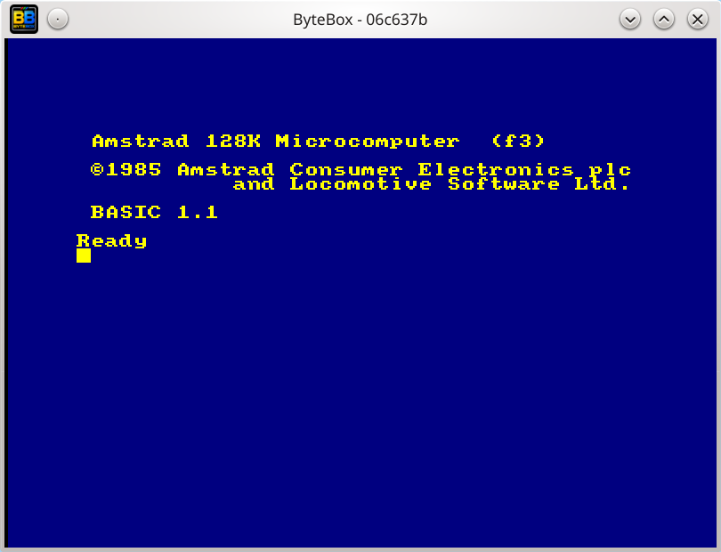

# Part 1: User manual

## Features

- One native executable for Linux, Windows and macOS (Apple silicon), built on
  SDL2. The French and English system ROMs and AMSDOS are built in: there is
  nothing to install before the first launch.
- CRTC type 0 and Gate Array timing modelled on Longshot's
  [Amstrad CPC CRTC Compendium](https://shaker.logonsystem.eu/ACCC1.11-EN.pdf)
  and checked against test programs. ByteBox runs SHAKER (Longshot's CRTC and
  Gate Array suite) and Kevin Thacker's Acid
  tests, see [Conformance](#conformance). *(Version 2.3.)*
- Automation compatible with Amspirit: CSL scripts and SSM screenshot
  requests. A headless mode runs them without a window, for test benches and
  continuous integration. *(Coming in version 2.3.)*
- FUZIX, a small UNIX, runs on the 6128 with a hard disk, a real-time clock and
  up to 3.5 MB of extra RAM. One click installs and starts it.
- Expansions: X-MASS / Symbiface II IDE hard disk and DS12885 clock, RAM
  expansion up to 3.5 MB, software mouse, datacorder with audio, joystick and
  game controller, drive B.
- Debugging tools in the window: Z80 monitor with breakpoints, write
  watchpoints, read watchpoints and I/O breakpoints (2.3), instruction trace,
  single step by instruction or by video line, and a machine status window.
- French (AZERTY) or English (QWERTY) machine: ROMs, virtual keyboard and PC
  keyboard follow the chosen language. *(Coming in version 2.3.)*
- CRT shader (phosphor mask, scanlines), virtual keyboard, drag and drop of
  `.dsk`, `.cdt` and `.sna` files.
- Snapshots (`.SNA`) readable by other emulators, which makes ByteBox a quick
  target for Z80 development.

## Installation

Download the file for your system from the
[Releases page](https://github.com/nicolasbauw/bytebox-binary/releases).

**Linux (AppImage), any distribution:**

```sh
chmod +x bytebox-*-x86_64.AppImage
./bytebox-*-x86_64.AppImage
```

**Windows:** run `bytebox-*-x86_64.msi`.

**macOS (Homebrew):**

```sh
brew tap nicolasbauw/bytebox
brew install bytebox
```

Homebrew may ask you to trust the tap the first time; it prints the command to
run. The formula installs the executable and `ByteBox.app`; the notes printed at
the end of the installation give the command that links the application into
`/Applications`.

**macOS (Apple silicon), by hand:** extract `bytebox-*-macos-arm64.tar.gz`. It contains
the `bytebox` executable and `ByteBox.app`. The application is signed ad hoc
and not notarized. If macOS blocks it after download, remove the quarantine
attribute:

```sh
tar xzf bytebox-*-macos-arm64.tar.gz
xattr -dr com.apple.quarantine ByteBox.app bytebox
```

ByteBox creates what it needs at first launch:

| Path | Content |
|---|---|
| `~/.config/bytebox/config.toml` | Settings, see [Configuration file](#configuration-file) |
| `~/.bytebox/DSK` | Disk images found by name (`disk` command, `--disk`) |
| `~/.bytebox/CDT` | Tape images found by name |
| `~/.bytebox/SNA` | Snapshots, read and written here |
| `~/.bytebox/ROM` | Extra ROMs (FUZIX) |
| `~/.bytebox/FZX` | FUZIX disk image |

## Quick start

```sh
bytebox                                   # BASIC prompt
bytebox --disk=game.dsk --autocmd='RUN"GAME'
```

Drop a `.dsk`, `.cdt` or `.sna` file on the window to load it. A dropped disk
goes to drive A. The `F6` window and the console (`F10`, `F11`) offer the same
operations.

## Command-line options

| Option | Effect |
|---|---|
| `--help`, `-h` / `--version`, `-V` | Print the options (with examples) / the version of the build (2.3) |
| `--diag` | Load the diagnostics ROM in slot 0F |
| `--lang=fr\|en` | ROMs and keyboard for this session, not saved (2.3) |
| `--config=<file>` | Use another configuration file, read and saved instead of `~/.config/bytebox/config.toml`. A partial file is completed with the defaults (2.3) |
| `--disk=<file>`, `-d` | Insert a disk image in drive A. A bare file name is looked up in `[file] dsk_path` |
| `--tape=<file>`, `-t` | Insert a tape image |
| `--autocmd=<text>`, `-a` | Type a command once BASIC is ready. Also with `--headless` and `--debug` (2.3) |
| `--fuzix` | Start the installed FUZIX, like `Start FUZIX` in the settings window (2.3) |
| `--fuzix-disk=<file>` | Same, with another disk image, for example a copy: FUZIX writes to its disk (2.3) |
| `--snapshot=<file>`, `-s` | Resume from a `.SNA` snapshot instead of booting |
| `--script=<file>` | Run a CSL script (2.3) |
| `--ssm` | Act on SSM requests (2.3) |
| `--screenshot-dir=<dir>` | Where script and SSM screenshots go (default: current directory) (2.3) |
| `--frames=<N>` | Quit after N emulated frames (2.3) |
| `--audio-dump=<file>` | With `--headless`: save the sound as a WAV file (16-bit mono, 44.1 kHz) (2.3) |
| `--turbo` | No 50 Hz pacing, sound muted (2.3) |
| `--headless` | No window, no sound, no pacing (2.3) |
| `--debug` | Windowless debugging session: monitor commands, run until a breakpoint, symbols (2.3). See [Headless debugging session](#headless-debugging-session) |
| `--sym=<file>`, `--commands=<file>`, `-e <command>`, `--json` | Symbols, commands and output format of `--debug` (2.3) |

```sh
bytebox --disk=Barbarian.dsk --autocmd='RUN"BARBA.I'
bytebox --snapshot=demo.sna
```

Options marked (2.3) are not in release 2.2.0. They come with version 2.3.

`--headless` runs about 20 times faster than real time and logs to standard
error. It plays no sound, but `--audio-dump` keeps it in a WAV file. It stops at the end of the script (exit status 1 on a script error), on
an SSM `0000` pause, on a breakpoint or after `--frames`. One of `--script` or
`--frames` is required.

`--turbo`, the `turbo` console command and the Turbo box of the settings window
(`F6`, Hardware) remove the 50 Hz pacing (version 2.3). Turbo is suspended while
a key is held down, so that the CPC sees the real duration of a key press and
does not start repeating it.

## Function keys

| Key | Action |
|---|---|
| `F1` `F2` `F3` | Window size x1, x2, x3 |
| `F4` | Fullscreen |
| `F5` | CRT shader |
| `F6` | Settings window |
| `F7` | Virtual keyboard |
| `F8` | Step one Z80 instruction (while paused) |
| `F9` | Step one video line (while paused) |
| `F10` | Quick command bar |
| `F11` | Full console window (`Cmd+Shift+C` on macOS) |
| `F12` | Machine status window |

All commands and messages go through the quick command bar or the console
window, so starting from a desktop icon is the same as starting from a terminal.

## Settings window (F6)

The window applies changes at once, except where noted. `Save configuration`
writes the current values to `config.toml`.

**Hardware.** Model, drive B, mouse, Symbiface II clock, language (2.3),
diagnostics ROM, FUZIX ROM, extra RAM banks, and turbo (2.3, not saved). The
ROM slots and memory settings apply at the next power cycle.

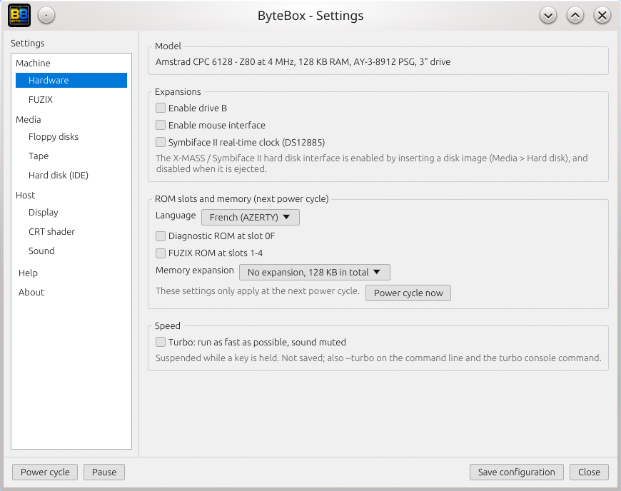

**FUZIX.** Installs and starts FUZIX, see [FUZIX](#fuzix).

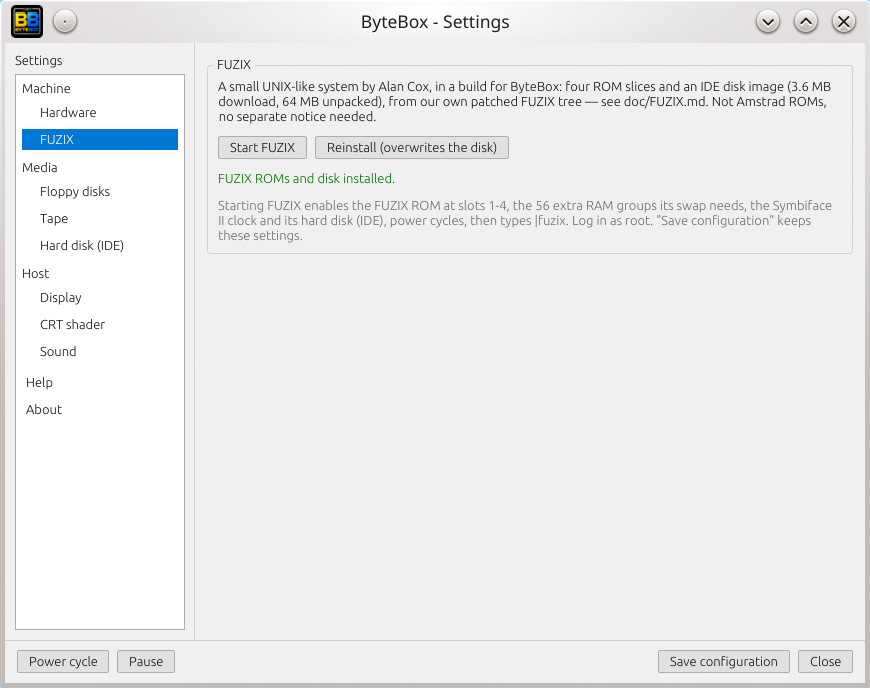

**Floppy disks.** Insert or eject drives A and B, create a blank formatted disk.

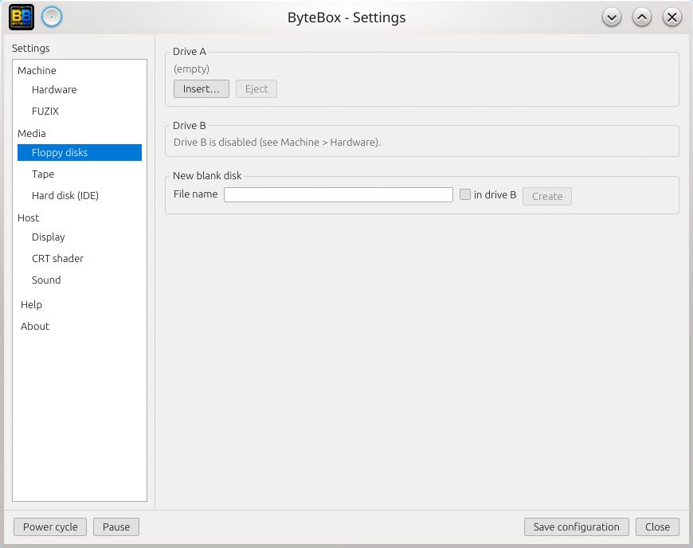

**Tape.** Insert or eject a `.cdt` image.

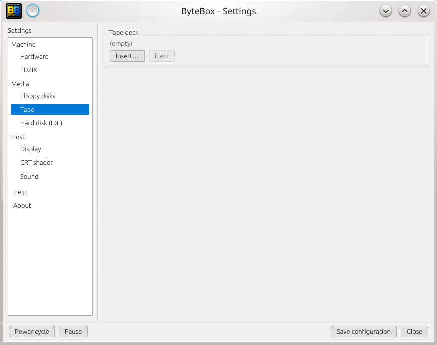

**Hard disk (IDE).** Inserting an image enables the X-MASS / Symbiface II IDE
interface, ejecting it disables the interface. The image is modified in place:
work on a copy.

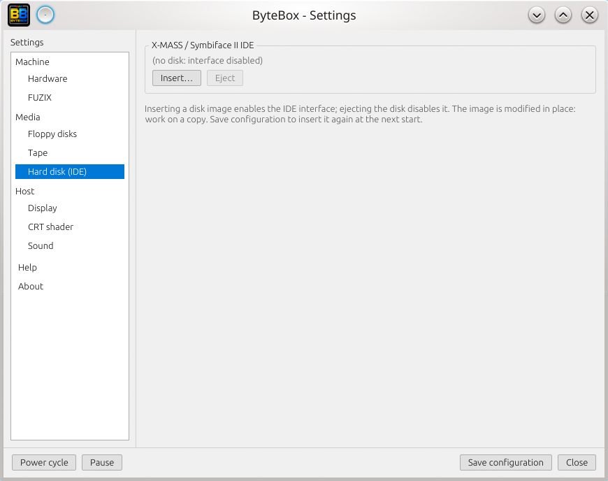

**Display.** Window size, disk access indicator, default size of the virtual
keyboard.

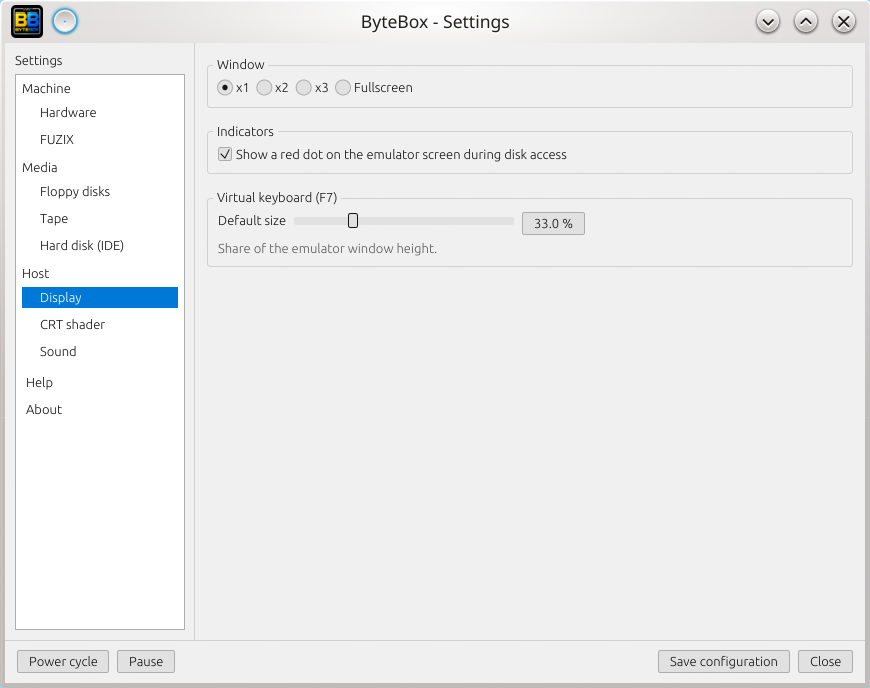

**CRT shader.** Every parameter of the effect, see [CRT shader](#crt-shader).

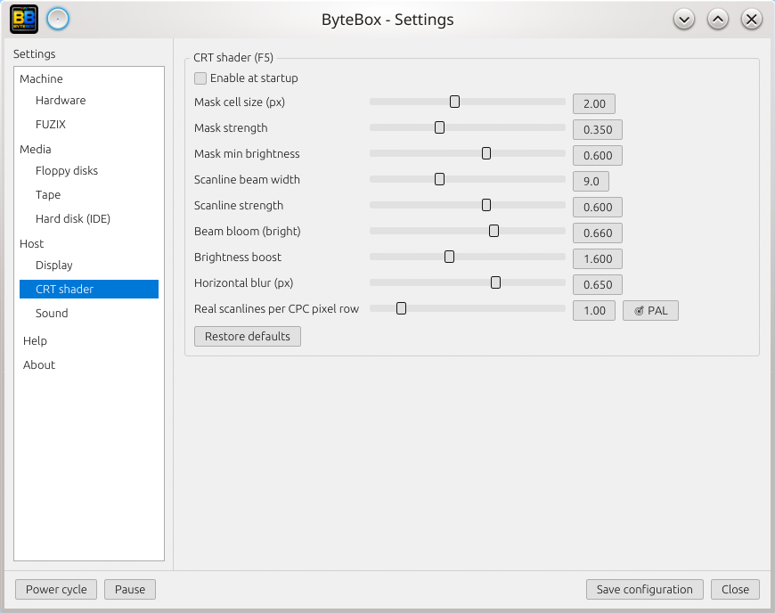

**Sound.** Output volume and tape signal level in the mix.

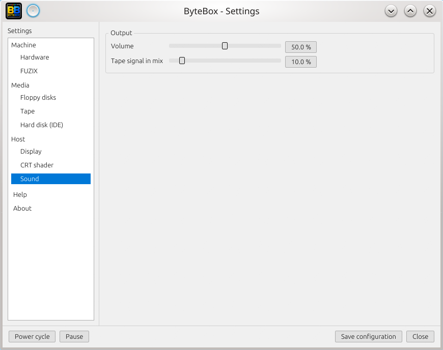

**Help.** The function keys and the console commands.

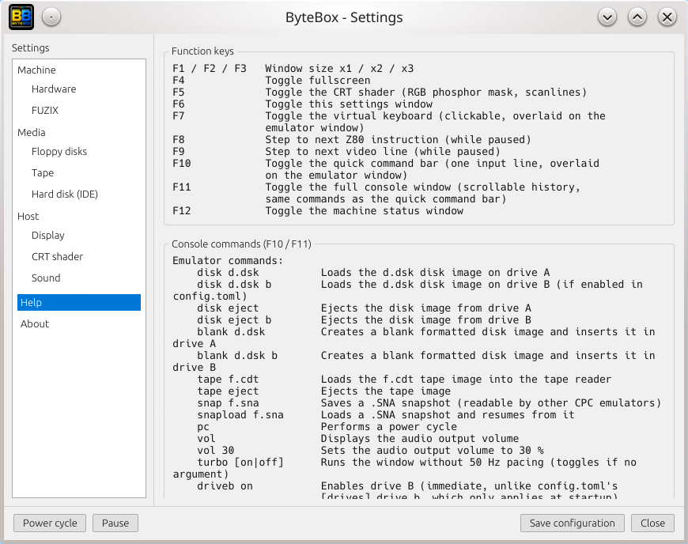

**About** (2.3). Version of the build: the tag for an official release, the last 7
characters of the commit hash for a development build. The window title shows
the same identifier.

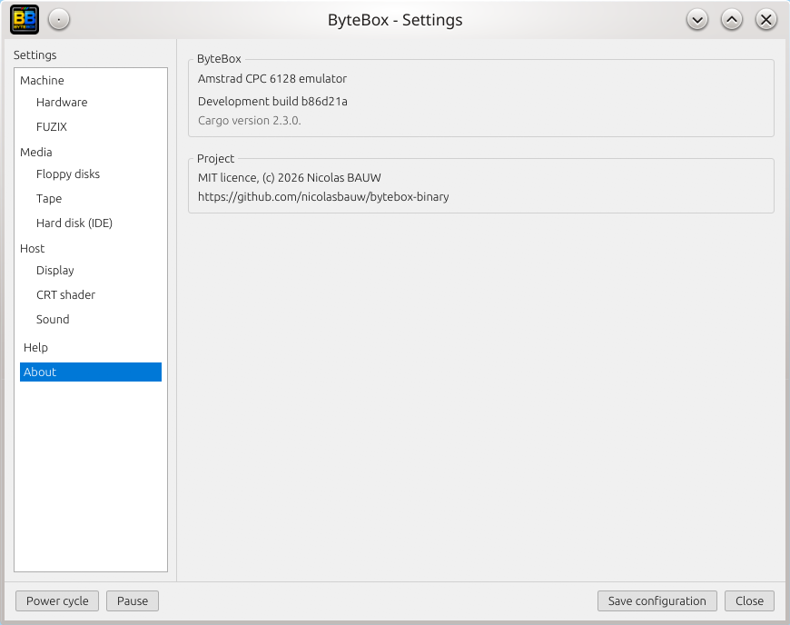

## Language and keyboard

> Coming in version 2.3. Release 2.2.0 is French only, and its virtual keyboard
> is a photograph of the French keyboard.

The machine is French (AZERTY ROMs) or English (QWERTY ROMs). Choose it in
`F6`, Hardware, Language. The choice is saved to `config.toml` and applies at
the next power cycle; the window offers to power cycle at once. The console
command `lang fr` or `lang en` does the same.

With the English ROMs the PC keyboard types the character printed on the key:
the `A` key of a French PC keyboard gives `A`, and `|` is AltGr+6. The right Alt
key is left free for AltGr; `COPY` is the left Alt key. The virtual keyboard is
drawn for the language in use.


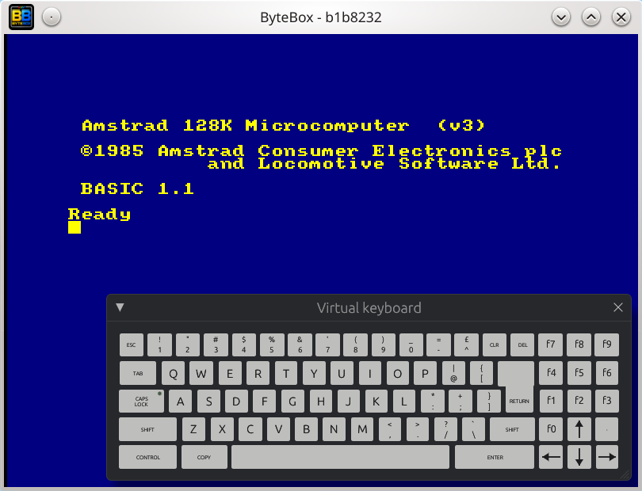

`SHIFT` and `CONTROL` of the virtual keyboard stay down until the next key.

## Media

**Disks.** `disk game.dsk` inserts an image in drive A, `disk game.dsk b` in
drive B (enable drive B first, `driveb on`). `blank new.dsk` creates a formatted
blank image and inserts it. Writes to a disk are saved to the image file sector
by sector, so work on a copy of a disk you want to keep.

**Tapes.** `tape game.cdt` inserts a tape. The datacorder motor is controlled by
the firmware as on a real machine, and the tape signal is mixed into the
sound while the motor runs. A power cycle keeps the tape inserted and rewinds
it. At the BASIC prompt, `CTRL` + the keypad `Enter` types `RUN"` (a firmware
feature).


**Hard disk.** `ide ~/disk.img` inserts a raw image and enables the X-MASS /
Symbiface II IDE interface (ports `&FD08` to `&FD0F`). `ide eject` removes it.

## FUZIX

[FUZIX](https://github.com/EtchedPixels/FUZIX) is a UNIX-like system by Alan
Cox. ByteBox runs a build of FUZIX for the CPC 6128, with four ROM slices, a
64 MB disk image on the IDE interface, the Symbiface II clock and the full
56 groups of extra RAM that its swap uses.

In `F6`, FUZIX page, click `Install and start FUZIX`. ByteBox downloads the ROM
slices and the disk image (3.6 MB, 64 MB unpacked) into `~/.bytebox`, then:

1. enables the FUZIX ROM in slots 1 to 4 and the 56 extra RAM groups;
2. inserts the disk image, which enables the IDE interface;
3. turns the Symbiface clock on, so that FUZIX does not ask for the date;
4. power cycles and types the command that starts FUZIX (`ùfuzix` with the
   French ROMs, `|fuzix` with the English ones).

Log in as `root`, without a password. Next time the page offers `Start FUZIX`.
`Save configuration` keeps the settings.

From the command line, `--fuzix` does the same as `Start FUZIX` (2.3).
`--fuzix-disk=<file>` starts it on another disk image: FUZIX writes to its disk,
so a copy keeps automated runs repeatable.

```sh
cp ~/.bytebox/FZX/disk.img /tmp/fuzix.img
bytebox --headless --fuzix-disk=/tmp/fuzix.img --script=session.csl
```

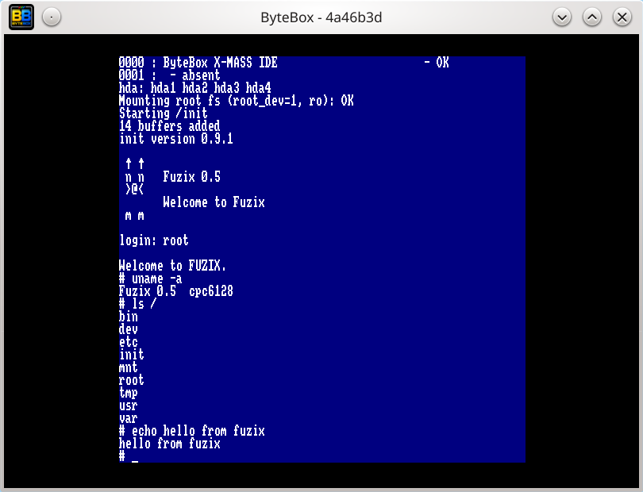

From version 2.3, the FUZIX keyboard follows the language of the machine: the
kernel takes the key translation tables of the OS ROM that is installed. With
the English ROMs the keys type what is printed on them, as in BASIC.

The FUZIX files are not Amstrad ROMs. More details, including how to start
FUZIX by hand, are in [doc/fuzix.md](doc/fuzix.md).

## Hardware details

**Extra RAM.** `ram 16` (or the slider in `F6`) adds 16 banks of 64 KB beyond
the 128 KB of the 6128, with the protocol of period third-party expansions. The
maximum is 56 banks (3.5 MB). It applies at the next power cycle.

**Joystick.** The first controller found at startup drives the CPC joystick port:
D-pad or left stick for directions, three buttons for fire 1, 2 and 3.
Controllers can be plugged in while ByteBox runs; an on-screen message names
the one that was picked up. Controllers known to SDL2 are used through its game
controller API. Others use a generic layout: the first two axes for directions,
the first three buttons for the fire buttons.

**Mouse.** A software mouse, off by default: enable it in `F6`, Hardware, or
with `mouse on`. It is a ByteBox device on ports `&FC00` to `&FC02`, not a copy
of a hardware adapter, see [Mouse interface](#mouse-interface). Click in the
window to capture the mouse, middle click to release it; buttons held at that
moment are released on the CPC side (2.3).

**Real-time clock.** The DS12885 of the Symbiface II (ports `&FD14` and `&FD15`)
reports the local time of the host.

**Drive B.** Off by default: `driveb on`, or `[drives] drive_b = true`.

## CRT shader

`F5` switches the image to the aspect of a tube: an RGB phosphor mask, a beam
profile that blends neighbouring pixels along a line, and dark gaps between
scanlines. The parameters are sliders in `F6`, CRT shader, and are saved with
`Save configuration`.

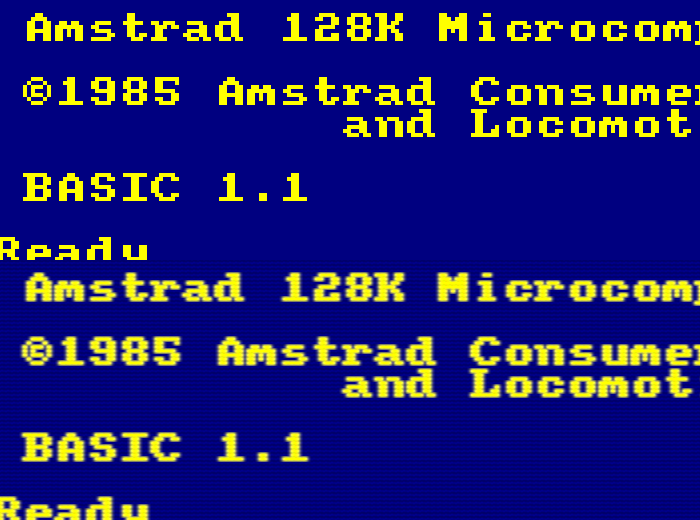

Scanlines follow the real CPC scanline period (286 per frame), not the frame
buffer rows. At x1 they are hard to see because each spans two output pixels;
x2 and x3 show them clearly. A partial `[crt]` section in `config.toml` is
valid, each field overrides one default:

```toml
[crt]
scanline_beam = 9.0
mask_cell_px = 2.0
```

## Console commands

Open the quick bar with `F10` or the console with `F11`. The `help` command
prints this list. The same functions are available in `F6`.

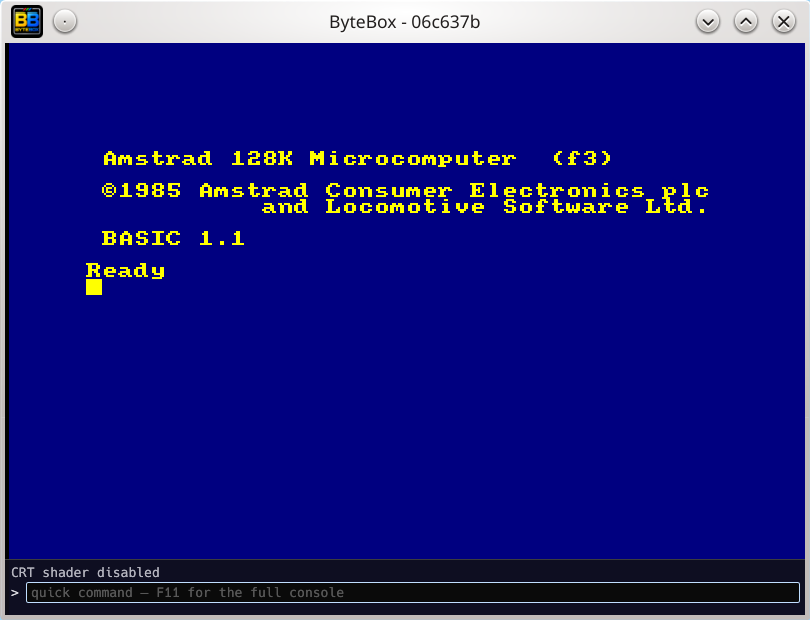

```text
disk d.dsk          Insert d.dsk in drive A
disk d.dsk b        Insert d.dsk in drive B (if enabled)
disk eject [b]      Eject drive A (or B)
blank d.dsk [b]     Create a blank formatted disk image and insert it
tape f.cdt          Insert a tape image
tape eject          Eject the tape
snap f.sna          Save a .SNA snapshot
snapload f.sna      Load a .SNA snapshot and resume
pc                  Power cycle
vol [n]             Show or set the output volume (percent)
tapevol n           Tape signal level in the mix (percent)
turbo [on|off]      No 50 Hz pacing, sound muted (2.3)
driveb on|off       Enable or disable drive B
ram n               Extra RAM banks (at the next power cycle)
lang fr|en          Language (at the next power cycle) (2.3)
diag on|off         Diagnostics ROM in slot 0F (at the next power cycle)
fuzixrom on|off     FUZIX ROMs in slots 1-4 (at the next power cycle)
ide x.img           Insert a hard disk image, enable the IDE interface
ide eject           Eject it, disable the interface
mouse on|off        Software mouse
rtc on|off          Symbiface II clock
```

## Monitor

The same console takes monitor commands. Addresses are hexadecimal with `0x`.

```text
d 0x0000            Disassemble 20 instructions
m 0xeeee            Show memory
m 0xeeee 0xaa       Write a byte
mr 0x1000 0x1100    Dump raw RAM, ignoring ROMs
s 0xaa              Search a byte in memory
n                   Step one instruction
l                   Step one video line
j 0x0000            Jump
b [addr]            List or set breakpoints
f addr              Delete a breakpoint
w [addr]            List or set write watchpoints (fw deletes)
rw [addr]           List or set read watchpoints (frw deletes) (2.3)
io [hh]             Break on IN or OUT to a port whose high byte is hh
                    (7F Gate Array, BC-BF CRTC, F4-F7 PPI; fio deletes) (2.3)
p                   Pause
g                   Resume
hw                  Gate Array and CRTC status
hw kb               Keyboard test
r                   Registers, flags, interrupts
t on                Record every executed instruction in a ring buffer
t calls             Record only jumps, calls and returns (longer reach)
t off               Stop recording, keep the buffer
t dump 100          Show the last 100 recorded instructions
t save f.txt        Write the whole buffer to a file
```

## Machine status window

`F12` opens a window with tabs for the Z80, Gate Array, CRTC, PPI, PSG, drives and
timing. The Gate Array tab shows RMR and MMR in hexadecimal and in bits, the
CRTC tab lists R0 to R17.

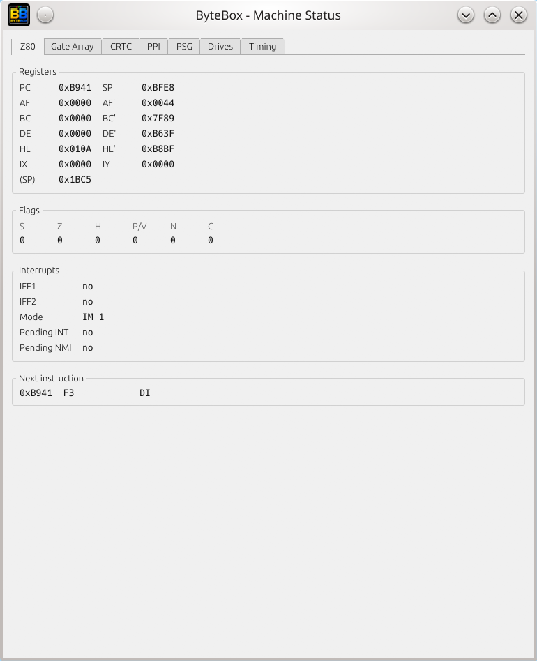

A typical session:

1. Open the status window with `F12`.
2. Set a breakpoint on the interrupt vector from the quick bar: `b 0x0038`.
3. The emulation stops when it is reached and the window shows the state.
4. Press `F8` repeatedly: the disassembly prints in the console and the
   registers update.
5. Press `F9` to advance one video line and watch the HSYNC counter and the
   scanline.

## Configuration file

ByteBox reads `~/.config/bytebox/config.toml` (also on Windows, under the home
directory). Every section is optional, and `Save configuration` rewrites only
the sections it manages, leaving comments and the rest untouched.

```toml
[drives]
drive_b = true

[file]
dsk_path = "~/.bytebox/DSK"
cdt_path = "~/.bytebox/CDT"
sna_path = "~/.bytebox/SNA"

[display]
default_zoom = "x2"          # x1, x2, x3, fullscreen
show_disk_access_indicator = true

[machine]
language = "en"              # fr (default) or en

[memory]
extra_ram_banks = 0          # 0 to 56

[ide]
enabled = true
image_path = "~/.bytebox/FZX/disk.img"

[rtc]
enabled = false              # Symbiface II clock

[mouse]
enabled = false

[rom]                        # optional, the ROMs are built in
# system = "~/roms/OS6128.rom"   # 16 KB, or a combined 32 KB OS + BASIC dump
# basic = "~/roms/BASIC1-1.ROM"
# amsdos = "~/roms/AMSDOS.ROM"
```

Extra ROM slots are declared with one block each:

```toml
[[rom.expansion]]
slot = 1
file = "~/.bytebox/ROM/FUZIX0.ROM"
```

## System ROMs

The OS 6128 and BASIC 1.1 ROMs (French and English), the AMSDOS ROM and the
[amstrad-diagnostics](https://github.com/llopis/amstrad-diagnostics) ROM (MIT
licence, used by `--diag`) are built into ByteBox. Amstrad has never stated its
position on redistributing the CPC ROMs, which have circulated freely in the
community for decades. They will be removed at the request of the rights
holder. The `[rom]` section replaces any of them; an unreadable file is
reported in the log and the built-in ROM is used.

## Conformance

ByteBox models the timing of the CRTC type 0 and of the Gate Array. Two test
suites are used as references. The runs and the figures below are those of the
development version of 2.3; they need the automation features of that version.

- **[SHAKER](https://shaker.logonsystem.eu/tests)** by Longshot (Logon System)
  exercises the CRTC and the Gate Array.
  Each test screen is compared with the references published on Shakerland:
  Amspirit-lite screenshots (pixel comparison) and photographs of a real
  machine. In November 2026, on the 472 sub-tests for CRTC type 0, 410 are
  identical to the Amspirit-lite reference, 33 are close, 28 differ and 1 is
  missing.
- **Acid tests** by Kevin Thacker are self-checking programs for the PPI, PSG,
  FDC, Z80, CRTC and Gate Array, whose verdicts were validated on real machines.
  The Z80 tests of Patrik Rak (documented and undocumented flags, MEMPTR,
  `SCF`/`CCF`) pass in full.

The type 1 and type 2 CRTCs are not emulated: a CSL script that selects another
type stops there.

Sources: the CRTC, Gate Array and Z80 instruction timings of ByteBox follow the
[Amstrad CPC CRTC Compendium](https://shaker.logonsystem.eu/ACCC1.11-EN.pdf) by Longshot (Logon
System), and are checked with its [SHAKER tests](https://shaker.logonsystem.eu/tests),
published on [Shakerland](https://shaker.logonsystem.eu). Many thanks to its
authors for years of reverse-engineering, shared under a Creative Commons
licence.

# Part 2: Developer corner

This part is for programming the CPC and for testing programs with ByteBox. The
examples are in `src` (Z80 and C sources) and `tools` (scripts). They were
assembled or compiled and run in ByteBox.

SSM requests, CSL scripts and the headless mode (`--ssm`, `--script`,
`--headless`) are not in release 2.2.0: they come with version 2.3. The sections
and the files that use them say so.

| File | Purpose |
|---|---|
| `src/border.asm` | Smallest program: set the border colour |
| `src/screen.asm` | Write to video memory (mode 1, four pens) |
| `src/irq-border.asm` | Interrupt handler that changes the border colour |
| `src/ssm-shot.asm` | Request screenshots from inside the program (SSM, 2.3) |
| `src/mouse-driver.asm` | Driver for the ByteBox software mouse |
| `src/mouse-demo.asm` | Move a block with the mouse |
| `src/c/crt0.s`, `src/c/bars.c` | C program built with SDCC |
| `tools/rasm-sna.sh` | Assemble a source into a snapshot |
| `tools/c-sna.sh` | Compile a C program into a snapshot |
| `tools/run.sh` | Resume a snapshot in the window |
| `tools/shot.sh` | Resume a snapshot without a window and save a screenshot (2.3) |
| `tools/csl/*.csl` | CSL script examples (2.3) |

## Snapshots and RASM

A `.SNA` snapshot restores the registers, the RAM and the hardware state. Built
by [RASM](https://github.com/EdouardBERGE/rasm), it starts your code directly
at its entry point: no disk image, no loading. ByteBox resumes it with
`--snapshot`.

Save this as `border.asm`:

```asm
        BUILDSNA V2         ; write a version 2 snapshot
        BANKSET 0           ; write to the 64K RAM
        ORG  #4000
        RUN  #4000          ; entry point stored in the snapshot

start
        ld   bc,#7F10       ; Gate Array: select the border
        out  (c),c
        ld   bc,#7F4C       ; set it to ink 12 (bright red)
        out  (c),c
loop
        jr   loop
```

Assemble and run:

```sh
rasm border.asm -oi border.sna -v2 && bytebox --snapshot=border.sna
```

or with the script of this repository, which also writes a symbol file:

```sh
tools/rasm-sna.sh src/border.asm && tools/run.sh border.sna
```


Points to know:

- **Use `BANKSET 0`.** RASM numbers memory in 16 KB banks: `BANK 0` is the area
  `#0000` to `#3FFF` whatever the `ORG`, so code assembled at `#4000` ends up at
  address `0` while the snapshot starts at `#4000`. A program can seem to work
  by running through zeroes up to `#FFFF` and wrapping around to `0`. With
  `BANKSET 0` the addresses of the source are the addresses in memory. Without
  `BANK` or `BANKSET`, RASM writes nothing and prints
  `Warning: No byte were written in snapshot memory`.
- **Use `-v2`** (or `BUILDSNA V2`). RASM writes version 3 snapshots by default,
  with compressed memory chunks. ByteBox refuses them, because loading them
  would give a machine with blank memory. Version 2 is a plain memory dump.
- **No firmware.** A RASM snapshot has empty RAM: the firmware jump block
  (`#BB5A` and the others) is not set up, so firmware calls do nothing. Write
  to video memory and to the hardware ports directly, as `screen.asm` does.
- **The stack must be in plain RAM.** With the ROMs mapped, a `RET` that reads
  below `#4000` or above `#C000` reads ROM, not what `PUSH` wrote (the ROMs
  mask reads, not writes). The default stack of a RASM snapshot is `SP=#C000`.
  Set your own, as in `ld sp,#BF00`.
- **Where snapshots live.** A bare name is looked up in `~/.bytebox/SNA`
  (`[file] sna_path`), where `snap` also writes. A name with a path is used as is.
- **Both directions.** `snap f.sna` in the console saves the current state and
  `snapload f.sna` restores it. Use it to park a hard-to-reach state: a level,
  a crash, a precise interrupt. The files also work in other emulators.
- **The debugger is available from the first instruction.** `F12`, breakpoints
  and single step all work as soon as the snapshot is loaded.

### Writing to video memory

`src/screen.asm` sets mode 1, programs four pens and fills the screen. In mode 1
a byte holds four pixels, and bytes `#00`, `#F0`, `#0F` and `#FF` give pens 0 to 3.

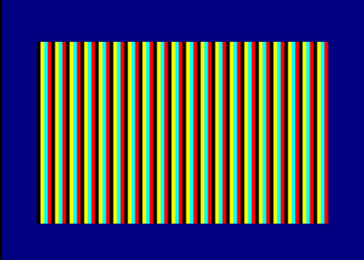

### Interrupts

The CPC raises 6 interrupts per frame, one every 52 scanlines. `src/irq-border.asm`
installs its own handler at `#0038` and changes the border colour at each one,
which paints bands. It switches both ROMs off first: with the lower ROM mapped,
the CPU reads the ROM at `#0038`, not the RAM you wrote.


Run it, open `F12`, and set `b 0x0038` in the quick bar to stop at each interrupt.

## SSM screenshots

> Coming in version 2.3. Release 2.2.0 ignores SSM requests.

SSM (ScreenShot Management) lets a program ask the emulator for a screenshot at
an exact cycle. The request is a pair of `ED` opcodes that do nothing on a real
Z80: `ED LL ED HH` asks for the capture numbered `HHLL`. With `--ssm`, ByteBox
saves `BYTEBOX_0_HHLL.png`.

| Code | Effect |
|---|---|
| `#0001` to `#FFFD` | Save `BYTEBOX_0_HHLL.png` |
| `#FFFE` | Save a screenshot |
| `#FFFF` | Save a snapshot |
| `#0000` | Pause the emulation (end of a headless run) |

`src/ssm-shot.asm` defines a macro and takes two captures, with a different
border colour each time:

```asm
        MACRO SSM code
        defb #ED,{code} & #FF,#ED,{code} / 256
        MEND

        SSM  #0001          ; saves BYTEBOX_0_0001.png at this exact cycle
```

```sh
tools/rasm-sna.sh src/ssm-shot.asm
bytebox --headless --snapshot=ssm-shot.sna --ssm --screenshot-dir=out --frames=100
```


The request happens at the cycle where the opcode runs, so captures can be
compared from one run to the next. Wait a few frames before the first request:
a screenshot taken before the first frame is drawn is black, and
`src/ssm-shot.asm` waits on the vertical sync for this reason. Without `--ssm`
the requests are ignored, except that they release a `wait_ssm` of a script.

## CSL scripts

> Coming in version 2.3. Release 2.2.0 has no `--script` option.

CSL (CPC Scripting Language) is a text format, one instruction per line, that
plays the user: reset, disk insertion, typing, waits in emulated microseconds,
screenshots. It is the format used by Amspirit and by SHAKER. Comments start
with `;`. Run a script with `--script`:

```sh
bytebox --script=test.csl                 # in the window
bytebox --headless --script=test.csl      # without a window
```

Instructions supported:

| Instruction | Effect |
|---|---|
| `csl_version 1.1` | Version of the language |
| `reset [soft]` | Hard reset (power cycle), or soft reset |
| `wait <us>` | Run for that many emulated microseconds |
| `disk_dir '<dir>'` | Directory of the disk images (default: next to the script) |
| `disk_insert [A\|B] '<file>'` | Insert a disk image |
| `key_delay <press> <gap> [<gap after RETURN>]` | Key timing in microseconds |
| `key_output '<text>'` | Type text. `\(NAME)` is a special key: `RET`, `ESC`, `TAB`, `CAP`, `SHI`, `CTR`, `COP`, `CLR`, `DEL`, `ENT`, `ARU` `ARR` `ARD` `ARL` (arrows), `FN0` to `FN9`. `{...}` presses keys together, `\(KOF)` removes the delay before the next key |
| `keyboard_write <r0>,...,<r9>` | Set the ten rows of the keyboard matrix |
| `wait_ssm <code>`, `wait_ssm0000` | Wait for an SSM request |
| `wait_vsyncoffon` | Wait for a vertical sync |
| `screenshot_dir '<dir>'`, `screenshot_name '<name>'` | Where and how to name captures |
| `screenshot [vsync]` | Save a screenshot |
| `snapshot_name '<name>'`, `snapshot` | Save a snapshot |
| `csl_load '<file>'` | Chain to another script |
| `crtc_select 0` | Only CRTC type 0 is emulated; another type stops the script |

A script is read as UTF-8, or as Latin-1 when it is not valid UTF-8 (scripts
written on Windows), so accented letters such as `ù` are typed (2.3).

The typed characters follow the language of the machine: a script written for
the French keyboard types the same text on the English one, because
`key_output` sends characters, not key positions.

The same key pressed twice in a row is always released for at least two
keyboard scans (40 ms) in between, whatever `key_delay` says (2.3). With the
standard one-frame gap, the firmware sometimes missed the release, and a doubled
letter was typed once.

Three examples are in `tools/csl`. The first boots BASIC, types a line and saves
a screenshot:

```text
csl_version 1.1
reset
wait 3000000                    ; the BASIC banner takes about 2 seconds
key_delay 70000 70000 400000    ; slower than the standard, like a human
key_output 'PRINT "HELLO"\(RET)'
wait 1000000
screenshot_dir "."
screenshot_name "boot-print"
screenshot
```

```sh
bytebox --headless --script=tools/csl/boot-print.csl
```

`tools/csl/disk-cat.csl` inserts a disk and lists it, and
`tools/csl/ssm-wait.csl` waits for a program to issue an SSM pause:

```sh
bytebox --headless --snapshot=ssm-shot.sna --ssm --script=tools/csl/ssm-wait.csl
```

In headless mode the exit status is 0 when the script completes, 1 on a script
error and 2 when nothing tells the run when to stop. A test bench can compare the
screenshots with references; this is how SHAKER is run.

## Automating ByteBox

> Coming in version 2.3.

Everything needed to run ByteBox from a script, a continuous integration job or
an AI assistant that only has a terminal is already described above. Together:

1. Build the program: `tools/rasm-sna.sh` or `tools/c-sna.sh` produce a snapshot
   and a `.sym` symbol file.
2. Run it without a window: `tools/shot.sh prog.sna out.png` for a quick look, or
   `bytebox --headless --snapshot=prog.sna --script=test.csl` to type, wait and
   take several screenshots. About 20 times faster than real time.
3. Look at the result: the PNG files are the output. The log goes to standard
   error and the exit status tells whether the script completed (0), failed (1)
   or had nothing to stop it (2).
4. Synchronise with the program: a program that issues an SSM request (see
   [SSM screenshots](#ssm-screenshots)) can ask for a screenshot at the right
   moment, or pause the run with `0000`, so the script does not depend on guessed
   delays.
5. Inspect memory and registers: the CSL `snapshot` instruction writes a `.SNA`
   file: a header with the registers and hardware state, followed by the 128 KB of
   standard RAM. Any hex dump tool reads it. A program can also ask for a
   snapshot with an SSM request.

The monitor is reachable too, through `--debug` (next section).

## Headless debugging session

> Coming in version 2.3.

`--debug` runs the machine without a window and reads monitor commands from
`-e` (repeatable), from `--commands <file>` (one per line) or from standard
input. Each command is echoed with `> `, followed by its output.

```sh
tools/rasm-sna.sh src/irq-border.asm irq-border.sna     # also writes irq-border.sym
bytebox --debug --snapshot=irq-border.sna --sym=irq-border.sym \
    -e "until 0x0038" -e "r" -e "d" -e "screen out.png"
```

It takes all the [monitor commands](#monitor) and adds the ones a windowless
machine needs, because nothing else makes it advance:

```text
run [n]             Run n video frames (1), stopping early on a breakpoint
g [n]               Run until a breakpoint or watchpoint (3000 frames at most)
until addr [n]      Run until PC = addr
frame n             Run until frame n
n [count]           Execute count instructions
over                Execute one instruction, a CALL or RST up to its return
d [addr] [count]    Disassemble (20 instructions from PC)
b addr A=05 HL=0xc000 (0x4000)=0x0a count 3
                    Conditional breakpoint: every condition must hold, from
                    the 3rd time on
type text           Type text on the keyboard (\n is RETURN)
screen f.png        Save the current image as PNG
sym f               Load assembler symbols (RASM -s, sjasmplus, pasmo, SDCC)
trace addr "x={(&a000)} hl={HL} f={frame}"
                    Note a line each time PC reaches addr, without stopping
```

Symbols are accepted wherever an address is expected (`until main`,
`d draw+4`) and shown in the disassembly and the registers. Addresses can also be
written `&4000`, `$4000` or `4000h`. `help` lists everything. `--disk` and
`--tape` insert media, as usual, and `--autocmd` types its command during the
first `run` commands, once BASIC is ready (2.3):

```sh
bytebox --debug --disk=game.dsk --autocmd='RUN"GAME' -e "run 1500" -e "screen s.png"
```

With `--json`, each command prints one JSON line: the command, whether it
succeeded, its text output, the emulator messages, the tracepoint lines, why the
run stopped (`breakpoint`, `limit` or `done`) and the Z80 registers. `json regs`,
`json mem addr [len]`, `json hw` and `json sym` return the registers, memory,
hardware state (Gate Array, CRTC, PSG, keyboard) and symbols as JSON. This is the
mode for a script or an AI assistant: every answer can be parsed.
`tools/debug_driver.py` is a Python example of such a session.

## Debugging a program

Load the snapshot, then use the monitor of the console (`F10` or `F11`) and the
status window (`F12`).

```text
b 0x4010            break at an address
w 0x8000            break when the program writes to 0x8000
rw 0x8000           break when it reads 0x8000 (2.3)
io 0x7f             break on any access to the Gate Array (2.3)
g                   resume
n                   step one instruction
l                   step one video line
r                   registers
d 0x4000            disassemble from an address
t calls             record calls and returns, then t dump 100
```

Addresses are the ones in the symbol file written by `tools/rasm-sna.sh`.
`irq-border.asm` is a good first target: `b 0x0038` stops at each interrupt, `n`
steps through the handler and `F9` follows the video line.

## C programs with SDCC

Any compiler that targets the Z80 works, since ByteBox starts from a snapshot.
`tools/c-sna.sh` builds a C program with [SDCC](https://sdcc.sourceforge.net) and
wraps it into a snapshot with RASM. It needs `sdcc`, `sdasz80` and `makebin`
from the SDCC package.

```sh
tools/c-sna.sh src/c/bars.c
tools/run.sh bars.sna
```

`src/c/bars.c` cycles the border colour once per frame:

```c
/* 16-bit I/O ports: __banked makes SDCC load the whole address into BC. */
__sfr __banked __at(0x7f00) gate_array;   /* Gate Array */
__sfr __banked __at(0xf500) ppi_port_b;   /* PPI port B, bit 0 = vertical sync */

static void set_border(unsigned char hw_colour)
{
    gate_array = 0x10;                    /* select the border */
    gate_array = 0x40 | hw_colour;        /* hardware colour 0-31 */
}

static void wait_frame(void)
{
    while (ppi_port_b & 1)
        ;
    while (!(ppi_port_b & 1))
        ;
}

void main(void)
{
    unsigned char colour = 0;

    for (;;) {
        wait_frame();
        set_border(colour++ & 31);
    }
}
```

`src/c/crt0.s` is the start-up code: it disables interrupts, puts the stack at
`#BF00` and calls `main`. The script links code at `#4010` and data at `#8000`.
The same rules as for assembly apply: no firmware, and the stack in plain RAM.
Initialised global variables need start-up code that copies them, which this
minimal `crt0.s` does not do: keep to local variables and constants, or extend
the file.

## Mouse interface

The software mouse is read on three ports of the `&FC00` page, which no real
component uses:

| Port | Register | Behaviour |
|---|---|---|
| `&FC00` | Delta X | Signed byte, consumed by the read. Motion beyond -128..127 is kept for the following reads (2.3) |
| `&FC01` | Delta Y | Same as `&FC00` |
| `&FC02` | Buttons | Bit 0 left, bit 1 right. Not cleared by the read |

While the mouse is disabled, the three ports read `&FF`. Test `&FC02` to detect
it: an enabled mouse never reads `&FF` there, while a program that took `&FF`
for a delta would see a move of -1 on every read. Enabled but not captured, the
ports read 0. Enable it with `mouse on`, then click in the window to capture
the host mouse. The middle button releases it and never reaches the CPC.
Releasing the capture, by middle click, focus loss or an open panel, also
releases the buttons and drops pending motion on the CPC side (2.3). The real
CPC has no mouse: a program that needs one should keep a joystick or keyboard
fallback.

`src/mouse-driver.asm` reads the ports and accumulates the position;
`src/mouse-demo.asm` uses it to move a block, and a right click clears the screen:

```sh
tools/rasm-sna.sh src/mouse-demo.asm && tools/run.sh mouse-demo.sna
```

## Tools

| Script | Usage |
|---|---|
| `tools/rasm-sna.sh <src.asm> [out.sna]` | Assemble with RASM into a version 2 snapshot and a `.sym` file. `$RASM` overrides the executable |
| `tools/c-sna.sh <prog.c> [out.sna]` | Compile with SDCC and wrap into a snapshot |
| `tools/run.sh <snapshot>` | `bytebox --snapshot=<snapshot>`. `$BYTEBOX` overrides the executable |
| `tools/shot.sh <snapshot> <out.png> [us]` | Headless run, screenshot after `us` emulated microseconds (default 2 s). Needs 2.3 |
| `tools/debug_driver.py --snapshot <f.sna> --sym <f.sym> --label <name>` | Python driver for a `--debug --json` session: stops on a label several times, reads registers and memory, checks an expectation (exit status 0 or 1). `$BYTEBOX` overrides the executable. Needs 2.3 |

## License

The samples and scripts in this repository are under the MIT licence, see
`LICENSE`. ByteBox is by Nicolas BAUW.
