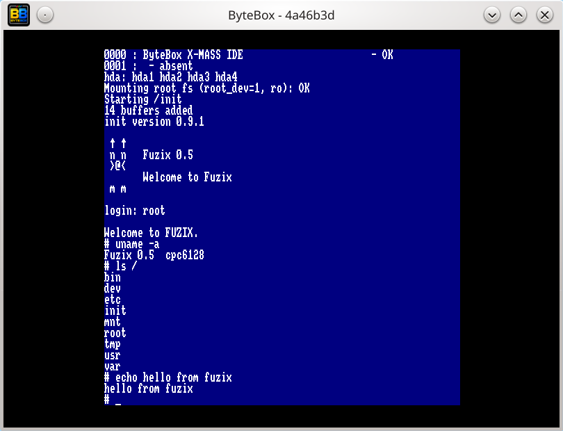
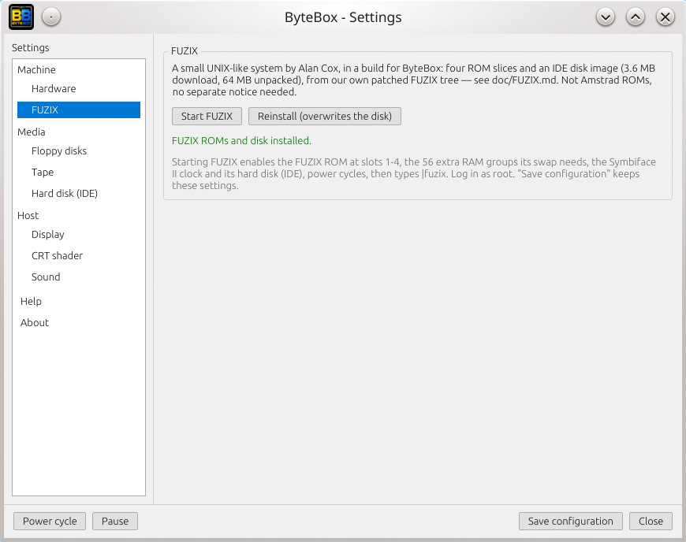

# FUZIX on ByteBox

[FUZIX](https://github.com/EtchedPixels/FUZIX) is a small UNIX-like system by
Alan Cox, for machines with 8-bit processors. ByteBox runs a build of FUZIX for
the Amstrad CPC 6128. The CPC 6128 port of FUZIX is by Antonio J. Casado Alias.



## What you get

- A shell with the usual utilities: `ls`, `cat`, `cp`, `ed`, `vi`, `more`, `ps`,
  `date`, `mount`, `fsck` and others.
- The kernel uses 128 KB of RAM. 64 KB are available to processes, up to 48
  processes. Swap lives in the extra RAM (56 groups of 64 KB, 3.5 MB).
- A 64 MB disk on the X-MASS / Symbiface II IDE interface, with four partitions
  (`hda1` to `hda4`). The root file system is on `hda1`.
- The Symbiface II real-time clock: FUZIX reads it at boot and does not ask for
  the date and time.
- From version 2.3, the keyboard of FUZIX follows the language of the machine,
  see [Keyboard](#keyboard).

## Install and start

Open the settings window (`F6`), FUZIX page, and click `Install and start FUZIX`.



ByteBox downloads four ROM slices and the disk image (3.6 MB, 64 MB once
unpacked) into `~/.bytebox`, then:

1. enables the FUZIX ROM in slots 1 to 4 and 56 extra RAM groups;
2. inserts the disk image, which enables the IDE interface;
3. turns the Symbiface II clock on;
4. power cycles and types the command that starts FUZIX: `ùfuzix` with the
   French ROMs, `|fuzix` with the English ones.

The boot takes a little while: `turbo on` in the quick bar (`F10`) shortens the
wait. At the `login:` prompt, type `root`. There is no password.

Next time, the page offers `Start FUZIX`. `Reinstall` downloads the disk again
and overwrites it, losing everything written in it. `Save configuration` keeps
the settings, so that the FUZIX ROMs and the disk are present at every start.

## Starting by hand

The same result without the page:

```toml
# ~/.config/bytebox/config.toml
[memory]
extra_ram_banks = 56

[ide]
enabled = true
image_path = "~/.bytebox/FZX/disk.img"

[rtc]
enabled = true

[[rom.expansion]]
slot = 1
file = "~/.bytebox/ROM/FUZIX0.ROM"

[[rom.expansion]]
slot = 2
file = "~/.bytebox/ROM/FUZIX1.ROM"

[[rom.expansion]]
slot = 3
file = "~/.bytebox/ROM/FUZIX2.ROM"

[[rom.expansion]]
slot = 4
file = "~/.bytebox/ROM/FUZIX3.ROM"
```

At the BASIC prompt, type `|fuzix` (`ùfuzix` with the French ROMs). The console
offers the same settings: `fuzixrom on`, `ram 56`, `ide ~/.bytebox/FZX/disk.img`,
`rtc on`, then `pc` to power cycle.

## Keyboard

This applies from version 2.3. With release 2.2.0 the keyboard of FUZIX is AZERTY.

At start, the ROM loader asks the OS ROM that is installed for the translation
of each key, with and without `SHIFT`, and passes it to the kernel. The keys
therefore type what they type in BASIC: AZERTY with the French ROMs, QWERTY
with the English ones. The AZERTY table compiled into the kernel is only a
fallback for loaders that pass nothing.
Change the language in `F6`, Hardware, then power cycle (`pc`) and start FUZIX
again.

Function keys, cursor keys, `DEL`, `TAB`, `ESC`, `CAPS LOCK`, `SHIFT` and
`CONTROL` keep the codes of FUZIX. `CONTROL` + a letter gives the control
character.

With the French ROMs, some keys draw accented letters on the screen, but they
produce ordinary ASCII: the key labelled `ù` types `|`, `é` types `{`, `è`
types `}`, `ç` types `\`, `à` types `@`. The shell and its pipes are usable
from a French keyboard.

## Stopping

Run `shutdown` (or `halt`) before closing ByteBox. Closing the window while FUZIX
runs leaves the file system marked as not cleanly unmounted: the next boot
asks to check it.

```text
# shutdown
```

If it does ask whether to continue after reporting the file system as dirty,
answer `y`.

## Limits

- No network card and no serial port (the USIFAC serial card is not emulated).
- One screen console, 64 columns by 32 rows.
- The disk image is modified in place. Work on a copy to keep a known state.

## Files

| File | Content |
|---|---|
| `~/.bytebox/ROM/FUZIX0.ROM` to `FUZIX3.ROM` | Kernel, in four 16 KB ROM slices (slots 1 to 4) |
| `~/.bytebox/FZX/disk.img` | 64 MB disk image |

## Source

FUZIX is free software, licensed under the GNU GPL v2 (see the
[FUZIX project](https://github.com/EtchedPixels/FUZIX)). The kernel in the ROM
slices is built from
[FUZIX-patched-cpc-msx2](https://github.com/nicolasbauw/FUZIX-patched-cpc-msx2),
a fork of FUZIX: the branch `cpc-local` holds the CPC 6128 port with the
changes made for ByteBox. The files above are not Amstrad ROMs.
